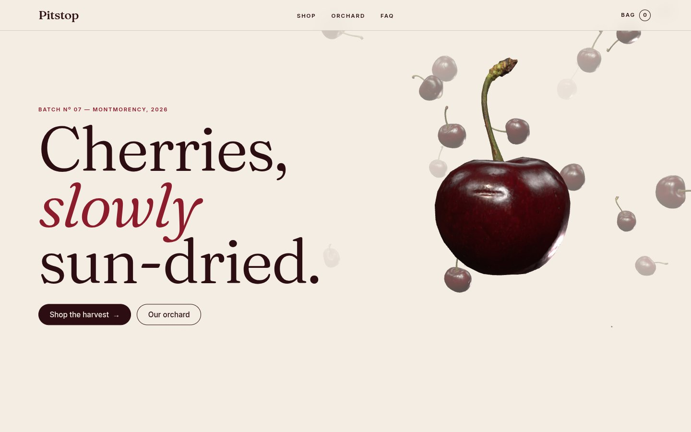
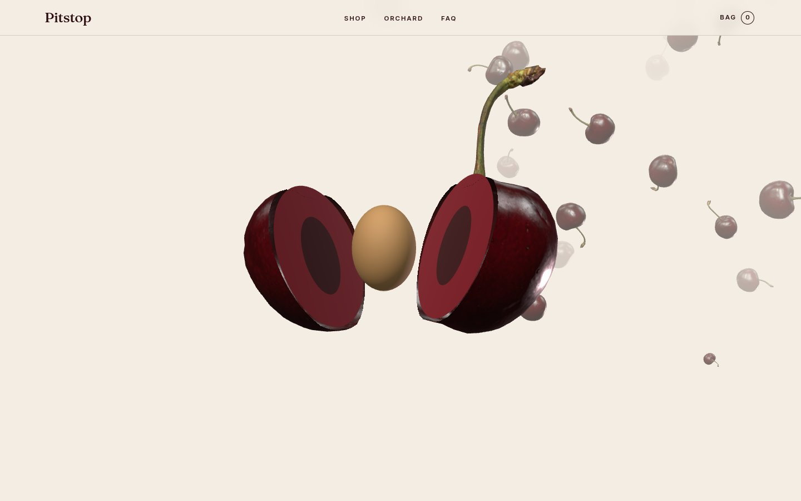
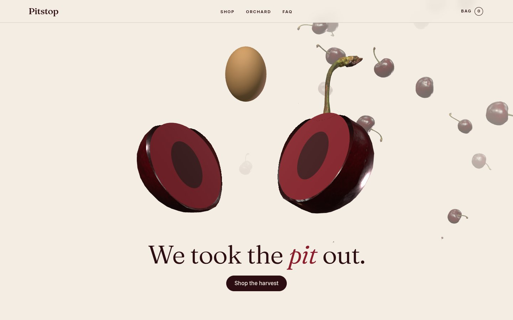
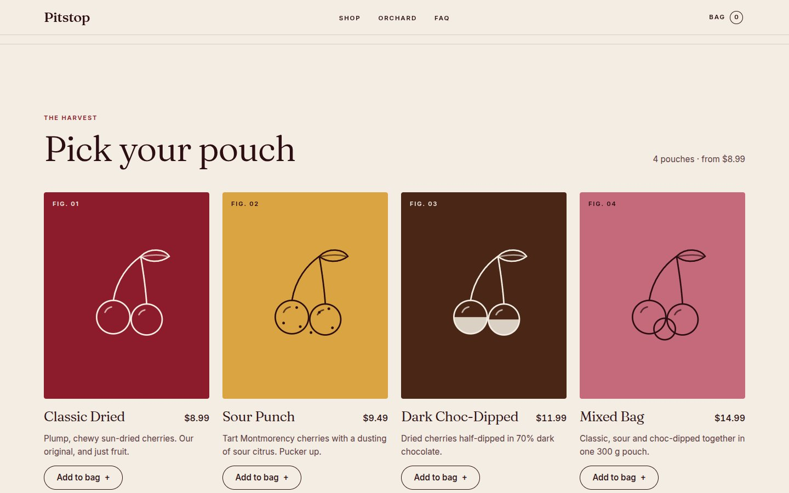
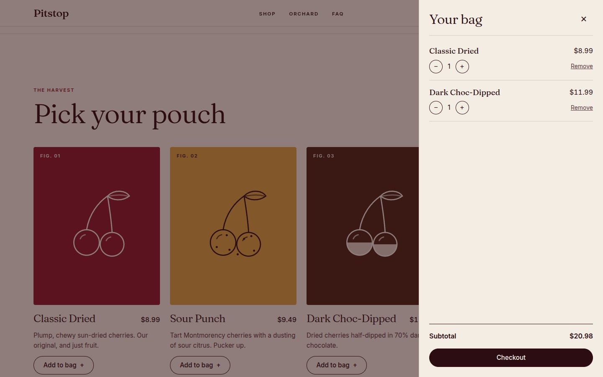
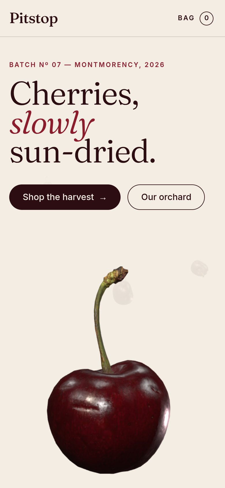
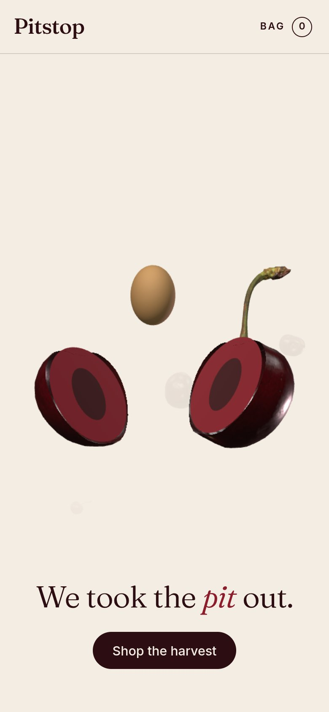

# Pitstop Cherries

Landing page and demo shop for Pitstop, an invented dried-cherry snack brand. Scrolling
through the hero splits a photoreal 3D cherry in half and lifts its pit out ("We took the
pit out."). The bag works and is saved in the browser, and checkout places a demo order.
No payments, no backend.

**Live site:** https://bigk-out.github.io/pitstop/

## Stack

| Layer | What it uses |
| ----- | ------------ |
| UI | [React 18](https://react.dev) with plain CSS (custom properties, no CSS framework) |
| Build | [Vite 5](https://vitejs.dev); a small build-time plugin (`build/seo.js`) adds meta tags and product JSON-LD |
| 3D | [three.js 0.160](https://threejs.org) via [React Three Fiber 8](https://docs.pmnd.rs/react-three-fiber); the cherry is a glTF model split live with GPU clipping planes |
| Scroll animation | A pinned (sticky) hero plus one pure timeline function, so there is no animation library |
| Type | Fraunces and Inter, self-hosted with [Fontsource](https://fontsource.org) variable fonts |
| State | React context and a reducer for the bag, persisted to `localStorage` and synced across tabs |
| Testing | [Vitest](https://vitest.dev) and Testing Library (unit), [Playwright](https://playwright.dev) in Chrome (end-to-end) |
| Quality | ESLint 9 (react, hooks, jsx-a11y) and Prettier 3 |
| Hosting | GitHub Pages, deployed by GitHub Actions on every push to `main` |

## Screenshots

| Hero | Split | Reveal |
| ---- | ----- | ------ |
|  |  |  |

| Shop | Bag |
| ---- | --- |
|  |  |

  
  

## Run it

    npm install
    npm run dev        # http://localhost:5173, opens in Chrome

## Scripts

| Command            | What it does                                   |
| ------------------ | ---------------------------------------------- |
| `npm run dev`      | Dev server with hot reload                     |
| `npm run build`    | Production build into `dist/`                  |
| `npm run preview`  | Serve the production build locally             |
| `npm test`         | Unit tests (Vitest)                            |
| `npm run test:e2e` | End-to-end tests in Chrome (Playwright)        |
| `npm run lint`     | ESLint + Prettier check                        |
| `npm run format`   | Format all files with Prettier                 |

## Editing the site

- **Text, products, prices, links:** `src/content.js`. Prices are in cents.
- **Colours and fonts:** tokens at the top of `src/styles/global.css` (Fraunces + Inter, self-hosted).
- **Site URL** (used for search and share previews): `brand.siteUrl` in `src/content.js`.

## The Pit Stop hero

The hero is pinned for three screens of scrolling while a 3D cherry splits and its pit
lifts out. The cherry is the photoreal model in `public/cherry.glb` (225 KB, WebP
textures); it is cut in half live with GPU clipping planes:

- `src/pitstop/timeline.js` — one function maps scroll progress (0–1) to every animated
  value; change timings there.
- `src/scene/cherryModel.js` — model URL, how the model is centred and scaled, and where
  the cut is. If you swap in a different model, re-measure these numbers.
- `src/scene/HeroCherry.jsx` / `heroGeometry.js` — the two clipped halves, the cut faces,
  the pit, and the motion.
- `src/scene/Floaters.jsx` — the small background cherries (same model); `sceneTier.js`
  sets how many.
- `src/components/SplitCherryArt.jsx` — static image used for reduced motion, browsers
  without WebGL, and while the 3D code loads.

The 3D scene mounts once the browser is idle, so static art shows first and first paint is
never blocked. Software WebGL renderers (detected in `webgl.js`) get a lighter tier from
`sceneTier.js` that renders on scroll instead of continuously.

## Deploying

See `SETUP_GUIDE.md`.
